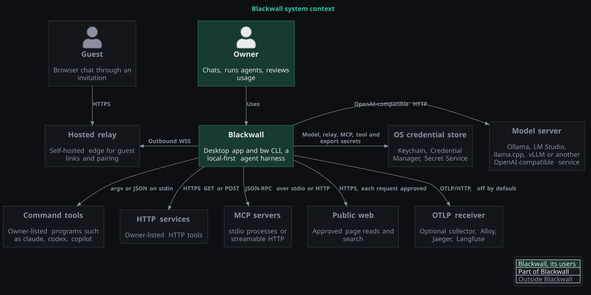
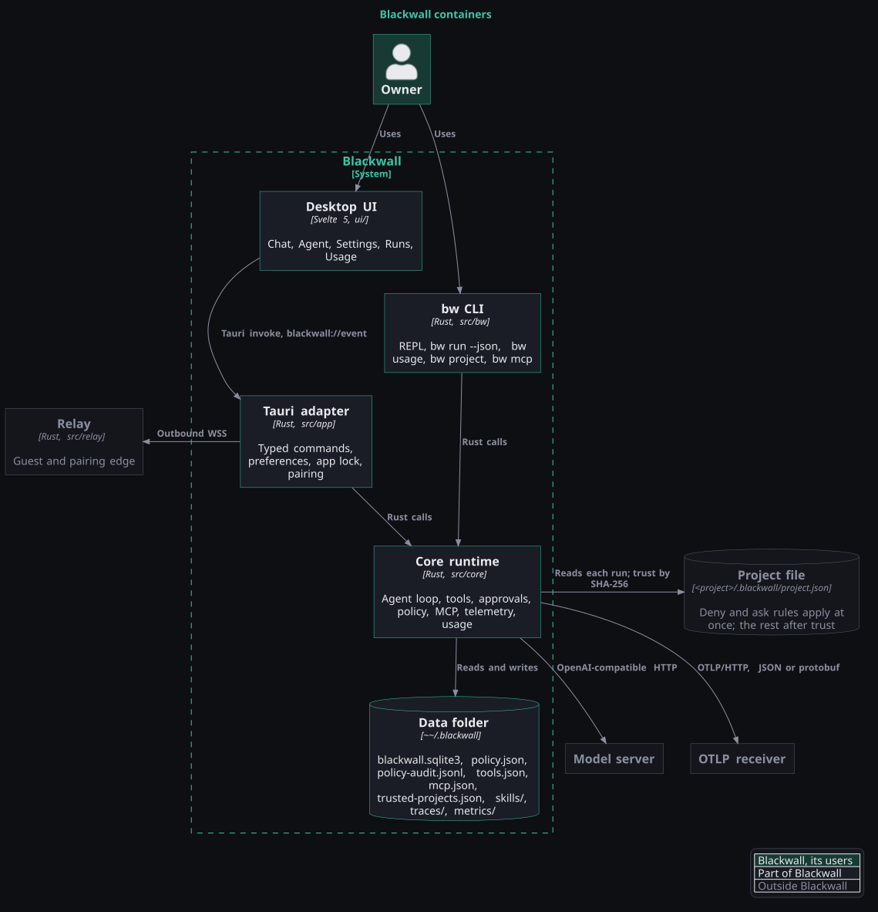
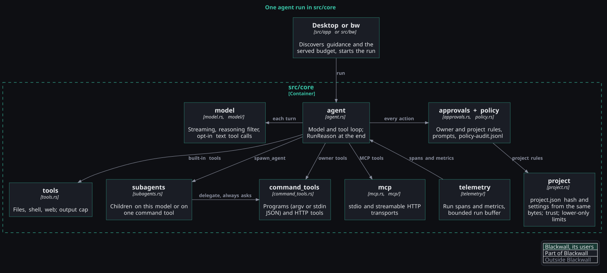

# Blackwall architecture

This document describes the desktop chat, project agent, durable local data, and guest-sharing
boundaries. [RELEASE_CHECKLIST.md](RELEASE_CHECKLIST.md) lists the remaining release gates.

## Context and containers

The diagrams follow the [C4 model](https://c4model.com) and are drawn with
[C4-PlantUML](https://github.com/plantuml-stdlib/C4-PlantUML); the sources are in
[diagrams/](diagrams/). The first shows what Blackwall talks to; every external
connection except the model server is off or empty until the owner sets it up.



The second shows the parts of Blackwall and the files it reads and writes.



## Runtime flow

```text
Svelte UI
  ├─ discover_models ──────────────┐
  └─ stream_chat + attachments ────┤ Tauri IPC
                                    ▼
                             blackwall-app
                               ├─ validates typed requests
                               ├─ normalizes the endpoint
                               ├─ applies time/size bounds
                               └─ emits blackwall://event
                                    │
                                    ▼
                          OpenAI-compatible endpoint
                          on a user-controlled machine
```

The desktop connects to an already-running model service. Guided setup lists the model servers
listening on this computer's loopback addresses (`core::connection::discover_local_services`, GET
probes only) and can explicitly request an allowlisted Ollama model download; it does not install or
start the server software. Endpoint selection is, in order:

1. an explicit trusted command request;
2. `BLACKWALL_MODEL_ENDPOINT`;
3. `OLLAMA_HOST`; or
4. the implementation-plan fallback `http://localhost:11434/v1`.

Origins without a path receive `/v1`. Only HTTP and HTTPS are accepted, and embedded URL
credentials are rejected. Model keys are resolved from the platform credential store by normalized
origin. `BLACKWALL_MODEL_API_KEY` is a fallback only for its configured origin. Model clients disable
redirects to avoid forwarding credentials to another service. New keys are tested before replacing
an existing saved entry.

`src/core/src/secrets.rs` is the only credential-store adapter: macOS Keychain through
`security-framework`, Windows Credential Manager and the Linux Secret Service through `keyring`.
Service and account names are identical on every platform, and there is no plain-text fallback when
a store is unavailable. Platform-specific process launching is limited to the approved shell tool
(`/bin/sh` with process groups on Unix, Windows PowerShell in a kill-on-close Job Object on Windows)
and the fixed browser opener used by guided setup.

## Guest share boundary

Guest sharing uses a separately deployable relay; it does not expose the host computer or upstream
OpenAI-compatible server directly. The desktop initiates the only connection from the owner side.

```text
Owner desktop ───── outbound WSS ─────► hosted relay ◄──── HTTPS ──── Guest browser
      │                                      │             Bearer invite key
      ▼                                      │
pinned OpenAI-compatible model               └──── streamed response ────► guest
on the configured machine
```

The relay origin comes from the saved Settings value or `BLACKWALL_RELAY_URL`; moving the service
requires no app rebuild. Registration tokens resolve from explicit input, origin-scoped Keychain,
then an origin-scoped `BLACKWALL_RELAY_TOKEN` fallback. Supplied tokens are saved after successful
registration. Settings exposes credential presence, verified model-key replacement, and deletion
without returning saved secret values to the UI. Public origins must use HTTPS/WSS, with loopback HTTP/WS allowed only for
development. The relay binary listens on a configurable address and is intended to sit behind a
TLS reverse proxy; the included Docker/Caddy deployment is described in [hosted guest
sharing](SHARING.md).

The desktop receives relayed guest bodies over its outbound socket, pins the model a second time,
and reaches the model through the endpoint selected when the invitation was created, with the
same environment/default fallback order as owner chat. The relay and guest never receive the upstream URL or model credential. A dropped
host socket is re-established with the same random host key while the invite remains active.

### Invite authentication

Creating a guest link creates independent random session, host, and guest credentials. The guest
credential is a 256-bit secret encoded in the URL fragment; the relay receives only its salted
digest during registration. The guest page clears the fragment from browser history, retains the
key in memory, and sends it as an `Authorization: Bearer` credential. The relay token and host key
are never placed in a guest URL.

The relay pins the owner's selected model before forwarding, and the desktop pins it again before
calling the upstream. The desktop manages up to four named invitations with separate credentials
and individual revocation. Each invite allows at most `2` guest chat requests in flight (eight per desktop). Expiry, the
owner's per-link **Revoke** action, **Stop sharing** for all links, or loss of the host session invalidates
the affected public route. Active relay sessions are memory-only. Public address ownership is
persisted separately as host-credential digests, preventing another host from claiming an offline
or previously used address. The desktop restores its original unexpired invitation after a relay
process restart. A private SQLite database and the Compose `relay_data` volume retain ownership;
no raw credentials, prompts, or responses are written there. See `SHARING.md` for capacity and
migration requirements.

Authorization and the two-request permit are extracted before Axum buffers the request body, so an
invalid or over-capacity caller cannot consume the 32 MiB body allowance. The browser measures the
exact serialized UTF-8 JSON before sending and trims oldest complete turns when accumulated image
history would cross that limit; the relay and desktop independently enforce request and response
limits. Host loss before headers returns a readable 502 JSON error; a midstream failure terminates
the stream. Abandoning a response releases its pending entry and request permit. Disconnect error
delivery is bounded so a guest that stops reading cannot indefinitely block revocation.

Anyone who obtains an unexpired invite URL has its authority. HTTPS/WSS protects traffic in transit,
but the first protocol is not application-level end-to-end encrypted, so the self-hosted relay is
inside the trust boundary and can observe forwarded chat content. See [hosted guest
sharing](SHARING.md) for deployment and the complete threat model.

## Package boundaries

- `ui/` owns presentation, interaction, local conversation summaries, attachment preparation, and
  browser-development transport. User-entered credential drafts exist in input controls; saved
  Keychain values are never returned to the UI.
- `src/app/` owns the Tauri shell, network client, endpoint policy, response limits, OpenAI-compatible
  serialization, and translation into typed UI events.
- `src/core/` owns the model transport, bounded agent/tool runtime, approvals, storage, memory,
  skills, web policy, and sharing protocol. It does not depend on Tauri or Svelte.
- `src/relay/` owns the separately deployable public HTTP/WebSocket edge and keeps sessions only in
  memory.
- `src/bw/` runs and resumes core agent tasks from the command line with explicit terminal approvals,
  or headlessly with JSON output and prompts denied.

Model/tool events use `blackwall://event`; setup download progress uses `blackwall://download`.
Both carry a request identifier.
The UI ignores unrelated or stale streams and can abort its active request.

## Attachments

The UI accepts at most eight attachments, 15 MiB each and 30 MiB combined. Images are sent as data
URLs to vision-capable endpoints. Small supported text files are decoded and enclosed as attachment
context. Other files retain their name, media type, and size, while their opaque binary contents are
not forwarded to a text-only model in this milestone. The Rust protocol independently enforces the
same count and byte limits at the IPC boundary.

Image preview object URLs are short-lived and revoked when removed or when a conversation is
released. Native sessions retain supported image/text payloads; opaque unsupported binary file contents
are not stored. Browser-only development history keeps metadata without the full attachment payload.

## Current persistence and trust model

Native history, preferences, and user-approved memory use versioned SQLite. Markdown skills live
in a restricted local directory. The platform credential store holds model/relay secrets, MCP server
secrets, and the optional app-lock verifier.
The data lifecycle and lock limits are described below.

The configured model machine and the self-hosted relay are inside the user's trust boundary. Do not
expose the raw model listener to the public internet. The relay keeps endpoint credentials and the
raw model address hidden behind an authenticated, expiring invite, but it can observe the chat
content it forwards.

Persistent pairing uses typed SQLite device records, per-address native credential-store services,
five-minute host-approved exchanges, and renewable host tunnels. Permanent relay revocation
markers reject stale reconnects. Pending approval records cannot start tunnels. One shared semaphore
limits guest and paired model work to eight requests per desktop process.

Native two-computer pairing acceptance, application-level end-to-end encryption, an operated default
relay, persisted guest telemetry, and signed/notarized public desktop distribution remain open. Named
temporary invitations are implemented; they are not permanent guest accounts.

## Agent execution and authority

`core::model` decodes bounded OpenAI-compatible streamed content and fragmented tool calls. It
keeps `<think>` text and `reasoning` fields apart from the answer (`model/think.rs`) and, only when
the connection opts in, reads `<tool_call>` blocks written as text (`model/text_tools.rs`); those
calls always ask. Before a request, the adapter asks `core::connection::served_budget` for the
server's loaded context window. `core::agent` runs up to the configured iteration limit (20
model/tool iterations by default, 1–100) and maps how a run ended to a `RunReason`, which `bw`
turns into its exit code. File tools use a directory capability selected
through the native folder picker; absolute paths, parent traversal, `.git`, and escapes outside the
project are rejected. Literal search is bounded and skips dependency folders. Edits display a unified
diff and compare the original file again before an atomic replacement.

Shell actions display the exact command and working directory. They run under the owner's
execution profile: **read-only** by default, **workspace-write**, or **unsandboxed** (full account
permissions). On macOS the restricted profiles are enforced by Seatbelt before the program starts,
and on Linux by bubblewrap; Windows refuses restricted profiles rather than run unconfined (see
[Runtime guide](RUNTIME_GUIDE.md)). Each command has a configurable deadline (two minutes by default), output
trimmed to its start and end above a configurable cap (64 KiB by default) with a stream stopped
past 64 MiB, and a process-group guard that kills descendants on cancellation. Known model,
relay, and signing secrets are removed from the inherited environment. In the unsandboxed profile other
account access remains possible and is covered by the explicit command approval.
Owner command tools, including a subagent's runs-on tool, run outside the profile with the owner's
account permissions unless the owner picks `sandboxed`. They always ask: an allow rule never skips
the prompt, a deny rule still denies, and the audit records the program that ran.

`core::approvals` binds decisions to an active request and exact action. “Allow identical action this
run” expires when the run ends. Dropping a pending action invalidates its decision handle.
`core::subagents` runs children with the owner's `SubagentSettings`: a step limit (eight by default)
and a subset of the built-in tools (read-only by default), whose edits, commands and web requests go
through the same `tools::execute`, approvals and policy as the parent's. Children never spawn more
children. With `RunsOn::Tool`, a child instead hands its prompt to one owner command tool as stdin
JSON through `CommandTool::delegate` and `Approvals::request_owner_tool`, which always asks, is
never remembered, and marks the prompt off-device. Read-only child batches run up to three
concurrently; anything else runs one at a time. `tools::OutputCap` trims command output to
`ContextBudget::max_output_bytes`; trusted `project.json` limits only lower these values.



Web access is disabled by default. Every request and redirect needs approval. The client disables
proxies and automatic redirects, validates all resolved IPs, pins DNS results, rejects private and
reserved ranges, and bounds response time and body size. Retrieved content is labeled untrusted.
The current search implementation uses DuckDuckGo's HTML endpoint and can be unavailable or blocked.

## Telemetry

`core::telemetry` owns one OpenTelemetry `SdkTracerProvider` and `SdkMeterProvider` per process.
Adapters start a `RunScope` for each Chat or Agent run and the core loops record spans and GenAI
metrics through it. The provider's only span processor buffers a whole run, applies the content
allowlist or the redaction scrub, and writes one OTLP/JSON file under `traces/`; a periodic reader
appends delta metrics to `metrics/YYYY-MM-DD.jsonl`. `core::trace` only reads trace files back.
`core::usage` reads the metrics files for a range of the viewer's local days and returns totals already
aggregated (`summary`), or copies the range's files to a folder (`export`); the desktop
`usage_summary` and `export_telemetry` commands and `bw usage` call it. `core::usage` also
writes and reads `metrics/recording.jsonl`, the recording on/off markers behind the gaps line.
`core::telemetry::export` is the optional OTLP/HTTP side: the trace writer thread and the metric
exporter hand it the same finished requests they write to the files, and its own thread POSTs them
(JSON or protobuf) with no redirects, a 10 s timeout, and a bounded queue that drops instead of
blocking. Nothing leaves the data folder unless the owner sets an endpoint. See
[Telemetry](TELEMETRY.md).

## Local data and app lock

`~/.blackwall/blackwall.sqlite3` stores versioned sessions, preferences, and FTS5 memory. Native history
retains supported attachment payloads. Migration is transactional and marked once; old browser data
is retained as a fallback copy. Preferences patches use an immediate SQLite transaction. The UI queues
failed writes in order and exposes retry/export without discarding the pending operations.

`~/.blackwall/skills/*.md` contains validated YAML-frontmatter Markdown skills. Agent context lists
enabled skills by name and description under a bounded budget, and the model loads one with
`read_skill`. After `/learn`, `skill_propose` records a proposal under `skills/.proposals`; nothing
is loaded until the owner approves it, and approval refuses a skill that changed after the proposal.
`policy.json`, `tools.json`, and `mcp.json` in the data folder hold owner rules, command tools, and
MCP servers. A project's `.blackwall/project.json` (`core/src/project.rs`) can add rules: its deny
and ask rules apply at once, and the rest waits until the owner trusts the file's SHA-256, recorded
in `trusted-projects.json`; `policy.rs` merges each file's answer, strictest across files. An MCP
server is reached through a `Transport` (`core/src/mcp/transport.rs`): a newline-framed stdio
process, or streamable HTTP (`core/src/mcp/http.rs`) with no proxy, same-origin redirects only, and
bounded replies. Only user-saved facts enter memory; automatic learning
and the optional Postgres adapter are not implemented. Guests never receive owner memory, skills,
workspace tools, or conversation history.

The optional desktop lock stores a salted Argon2id verifier in the credential store, rate-limits failed attempts,
and gates native data/model/tool commands. Locking cancels registered runs/downloads and revokes the
active shares; the UI flushes saves before clearing its conversation state. It does not encrypt the
SQLite database or protect against the same user account reading files or using `bw`. Native dialogs
recheck lock state after selection. Actions already accepted before a lock may finish; the lock is
not a filesystem or process isolation boundary.

## Not built yet

- Application-level end-to-end encryption between guests or paired computers and the host; the
  relay can read what it forwards.
- An external policy-hook program that decides actions from JSON on stdin.
- MCP servers that need OAuth sign-in; header secrets cover bearer tokens and API keys.
- MCP server notifications over a GET stream; Blackwall only posts and reads replies.
- Pricing for command-tool usage; the Usage page counts tokens, not money.
