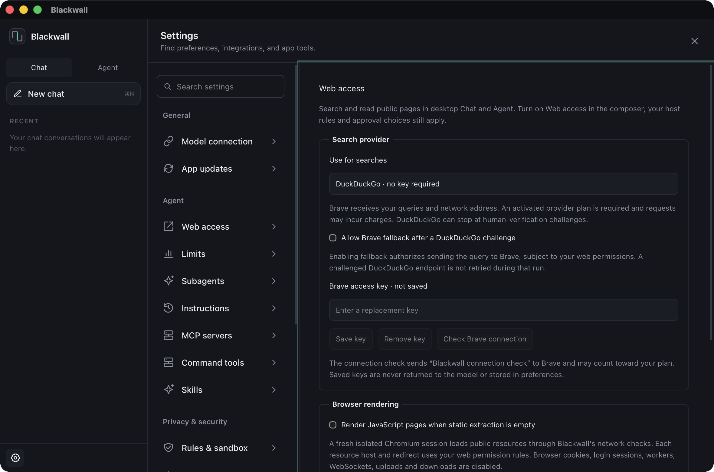
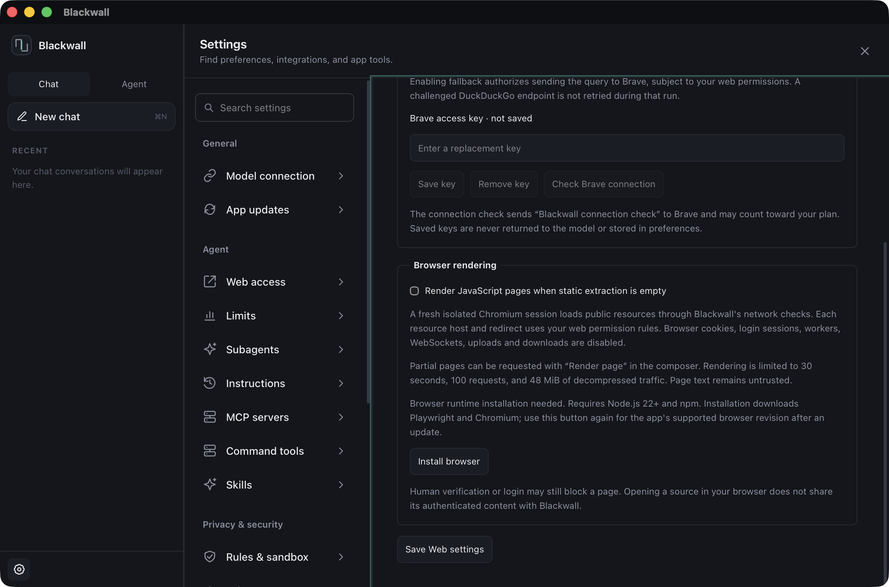

# Web access

Desktop Chat and Agent can search and read public pages when Web access is enabled. Owner and host
policy decisions still apply before network access. Browser mode has no shared-core tool backend:
its Web access checkbox is disabled with a visible explanation, and its IPC boundary rejects a web
request before contacting the model. Use the desktop app for research.


## Retrieval and failures

The built-in fetcher uses direct HTTP(S), verified TLS, pinned public DNS addresses, standard ports,
and no cookies, browser login, proxy, or referrer. It validates every redirect, checks that host's
permission, resolves and pins that destination independently, rejects mixed public/private DNS
answers, detects loops, and allows at most eight redirects. A redirect cannot transfer credentials
or reuse an earlier host's permission to override host rules. Reusable web permission retains its
existing scope; it never disables address validation.

Each hop has a five-second DNS timeout, a five-second connection timeout, and a 30-second request
timeout. Responses are limited to 2 MiB **after decompression**, counted while streaming rather than
trusting Content-Length. gzip, Brotli, and deflate are supported. The model receives at most 32,000
characters of text, with a trim notice, source URL and title. Source and diagnostic URLs omit query
strings, fragments and embedded credentials. The actual request still includes its query; search
approvals show the query separately so the owner can review what will be sent.

HTML extraction prefers article/main content, decodes entities, normalizes whitespace and removes
scripts, styles, templates, navigation and explicitly hidden elements. It does not execute
JavaScript or implement a browser's CSS/layout engine. Plain text, JSON and XHTML are supported;
PDFs, images and binary documents are refused. Text decoding honors a BOM, an HTTP charset, or an
HTML meta charset in the first 4 KiB, otherwise UTF-8. Unknown encodings and invalid text fail
explicitly. All source content remains untrusted.

Web failures carry `{"webError":{"category":"…","source":"…","message":"…"}}` in tool output,
with a typed core error and a stable category for telemetry. This preserves the existing event
protocol and saved conversations. The UI shows an actionable reason and source even with the tool
group collapsed. It preserves the protocol's `denied` bit through IPC and conversation storage,
so owner/policy denials are distinct from a website's HTTP 403. Other categories cover DNS, private
addresses, TLS, connectivity, timeouts, redirect loops/limits, HTTP 401/429, human-verification
challenges, unsupported documents/encodings, size limits, rendering needs and unavailable search.
Transport diagnostics classify the underlying cause without echoing raw errors or response headers.
Owner HTTP command tools explicitly disable automatic decoders and retain their identity-only,
64 KiB response contract despite reqwest's shared decoder features.

## Search setup and recovery

Open **Settings → Agent → Web access**. Both desktop Chat and Agent read the same owner settings
before each tool call. Existing installations retain DuckDuckGo, with paid fallback and browser
rendering disabled. Settings contain provider choices only; Brave keys stay in the platform
credential store and are bound to the fixed Brave API origin.



Choose **Brave Web Search API**, save an owner-provided key, and use **Check Brave connection**.
The button discloses its fixed query, `Blackwall connection check`, and possible plan charges before
sending it. A [Brave account and activated plan](https://api-dashboard.search.brave.com/documentation/quickstart)
are required; Blackwall does not create an account or include provider credits. Keys are write-only
through IPC: the UI receives their presence, never their saved value. Removing a key leaves the
provider selection intact and subsequent searches explain how to replace it or select DuckDuckGo.

Brave returns up to ten normalized title/URL/snippet results through the `SearchProvider` boundary.
The API credential goes only in a sensitive `X-Subscription-Token` header to the fixed HTTPS origin.
API requests use public DNS pinning, verified TLS, direct connections, a 30-second timeout and a
2 MiB decompressed response bound. Redirects are refused. Provider error bodies and headers are
never echoed to the model. Missing/revoked keys, quota exhaustion, rate limits, timeouts and
unavailable results have separate actionable outcomes. Retry-After seconds/dates and exhausted
Brave rate-limit reset windows suppress subsequent calls until the window expires. There are no
automatic paid retries.

DuckDuckGo remains a credential-free choice. Interstitials never count as search results. After a
challenge, its HTML endpoint is blocked for the rest of that run, including different queries.
**Allow Brave fallback** permits exactly the configured alternate after a challenge, with the
query disclosure, cost notice and Brave host's normal permission checks. Without that owner choice,
search stops and the tool card offers **Web access settings**. Provider selection never overrides
host denials or silently grants access to an additional company. An MCP search server remains an
independent Agent capability; Chat does not acquire Agent's MCP tools automatically.

## Optional browser rendering

On macOS, **Install browser** explicitly downloads the app-supported Playwright version and its
matching Chromium revision into the owner's application data directory (`browser/`). Node.js 22+
and npm must be available on the app's PATH. The adapter pins Playwright **1.64.1**. Browser updates
are deliberate: after updating Blackwall, use **Install / repair browser** for the supported
revision. No browser is downloaded at app startup or while fetching a page. An incomplete, missing
or outdated runtime produces `renderer_unavailable` with setup guidance.



Enable rendering and save settings to allow a single render attempt when HTTP extraction reports
`rendering_required`. Static pages keep the HTTP fast path. **Render page** below a successful web
result or an empty-shell failure drafts an explicit `web_fetch` request with `render=true` in the
composer, preserving existing draft text. Review/send the draft to ask the model to render a
partial shell that static extraction considered readable. Web access, renderer activation and
normal approvals still apply. This is a request through the model, rather than an immediate
out-of-band fetch.

The framework-free core defines the renderer and resource-broker interfaces. The separate
`blackwall-browser` crate owns the Playwright process and dependency installation. Each render
starts a fresh nonpersistent Chromium context. It never attaches to the owner's normal browser,
passes model/provider credentials, imports cookies/storage, or continues a challenged/login session.
The rendered DOM uses the same title/source extraction, challenge detection, untrusted-content
label and 32,000-character output cap as HTTP. Password forms report authentication; human
verification stays a challenge. Detection remains heuristic and cannot guarantee every site's
interstitial will be recognized.

### Browser network and resource scope

The entire Node/Chromium process tree runs under macOS `sandbox-exec` with **all network access
denied**. Chromium CDP Fetch intercepts initial and redirected requests, including frame resources.
This is the boundary against route/worker/WebSocket escape paths; interception alone is
not the security boundary. Every allowed GET is fulfilled over bounded stdio by Rust's public-web
HTTP broker. The broker validates URL schemes/ports/credentials, rejects all private/reserved or
mixed DNS answers, pins validated addresses for that connection, refuses automatic redirects and
rechecks destination hosts. Each browser redirect chain is limited to eight hops, with loop
detection. Browser headers, cookies, authorization and referrers are never copied.

Each resource host (including frames, scripts, styles and fetch/XHR) and each redirect uses the
existing host permission rules. A reusable Web approval permits these public resource reads only
where host rules permit it; an explicit host denial remains binding. Resources can disclose page
URLs/query data to additional public hosts, as the rendering approval and Settings explain.
Downloads, uploads/non-GET methods, unsupported schemes, service/shared/dedicated workers,
WebSockets, images and fonts are disabled. Missing styling/assets or blocked resources can limit
some applications; this is intentionally a public document reader.

Only one render or browser installation runs at a time. Rendering is limited to 30 seconds,
100 requests, **20 MiB per resource**, **48 MiB total decompressed traffic**, a 2 MiB rendered DOM
and 32,000 text characters. Network service work shares the render deadline. Cancellation, timeout
and completion kill the owned process group, including Chromium children; the adapter prevents
Playwright from detaching them into another process group. Linux and Windows currently report
isolated rendering unavailable; there is no fallback to an unsandboxed browser.

**Open source in browser** is an explicit owner action. It can help a person inspect a blocked
source; it does not make that browser's authenticated content readable by Blackwall. Use another
public source if automation stops. There is no human takeover/session-sharing design in this change.

## Verification — 2026-11-05

Offline tests cover selected API results through scripted Chat and Agent; a single DuckDuckGo
challenge and owner-selected/denied fallback; API normalization, key/quota/rate-limit failures,
redirect credential isolation, Retry-After parsing and output bounds; rendered challenge/login
failures, resource/private URL rejection, mixed/rebound DNS validation, cross-host resource denial,
cookie/header isolation, traffic/request caps and disabled/unavailable rendering.

An explicitly installed Chromium also passed offline integration fixtures for JavaScript-generated
tables, cross-origin scripts/fetches/frames, blocked workers/WebSockets/uploads, fresh storage,
cancellation, concurrency release, redirect loops/eight-hop limits, DOM/request bounds and timed
JavaScript waits. A separate OS test verifies an unintercepted descendant
connection cannot reach a local listener under the same sandbox profile. Browser tests require
explicit installation and do not download binaries during the normal suite:

```sh
cargo run --manifest-path src/Cargo.toml -p blackwall-browser --example probe -- /absolute/disposable/data --install
BLACKWALL_BROWSER_TEST_DIR=/absolute/disposable/data/browser cargo test --manifest-path src/Cargo.toml -p blackwall-browser --test isolation -- --include-ignored --test-threads=1
```

The public probe runs the production core + renderer + resource broker, bypassing only interactive
approval with an explicit allow-for-run decision. It starts no model. On November 5:

| Public source | Result |
| --- | --- |
| `https://example.com/` | Static HTTP; readable title/text, 231 total characters |
| [HELM MMLU](https://crfm.stanford.edu/helm/mmlu/latest/) | HTTP shell recovered by Chromium; 1,018 total characters with benchmark description and leaderboard model/score pairs |

HELM needed a roughly 16 MiB decompressed benchmark JSON response. The initial 8 MiB resource cap
rejected it; the final 20 MiB resource / 48 MiB total limits returned useful table text. These are
bounded observations, not a promise of universal website access. Native Settings was checked with
a disposable app data directory: provider and fallback defaults, browser installation/repair,
activation/save and missing-key setup state. Screenshots above are from that native window.
A native model-driven read was attempted using the required remote test model. It produced no
tool call before cancellation; the UI returned to idle with “Response stopped.” That attempt is
inconclusive and is not counted as a desktop research success. After switching to the owner-selected
Strata service, two model-catalog connection attempts timed out, including a direct five-second
TCP connection check. Live model verification remains blocked on that service; no fallback model
was used after the switch.
No Brave key was configured for the smoke; paid live API success remains unverified. Scripted
API fixtures cover successful search in both modes without contacting DuckDuckGo.

## Verification — 2026-11-02

The public probes below ran the actual shared-core retrieval path used by desktop, with TLS and
DNS/public-address checks enabled. They bypassed only interactive approval by an explicit test
allow decision; they did not run a model or the native desktop window. Counts include source/title
wrappers, so a clipped result can exceed 32,000 total characters.

| Public source | Desktop shared-core result | Browser UI |
| --- | --- | --- |
| `https://example.com/` | Readable text, title; 231 characters | Web access unavailable |
| `http://example.com/` | Readable text, title; 230 characters | Web access unavailable |
| [MDN CORS](https://developer.mozilla.org/en-US/docs/Web/HTTP/Guides/CORS) | Readable article; 27,473 characters | Web access unavailable |
| `https://github.com/` | Readable main content; 4,406 characters | Web access unavailable |
| [Wikipedia Rust](https://en.wikipedia.org/wiki/Rust_(programming_language)) | Readable text, clipped; 32,168 total characters | Web access unavailable |
| DuckDuckGo HTML, query `Rust documentation` | Parsed result titles and URLs; 728 characters | Web access unavailable |

The browser composer was also checked in Chromium with a mocked model catalog: Web access was
disabled and unchecked, with the visible desktop-app explanation (screenshot above). An offline
IPC test verifies browser web requests perform no fetch at all. Browser research through the model
is intentionally unavailable. Native desktop model-driven research was not manually exercised;
the scripted Chat/Agent and UI tests cover dispatch, approval, errors, storage and presentation.

Offline local-server fixtures cover useful HTML, >256 KiB pages, four redirects, loops, more than
eight redirects, cross-host denial, private/credential-bearing destinations, mixed DNS answers,
401/403/429, 200/202 challenges, compression and expansion limits, chunked oversized responses,
charsets/BOM/meta encodings, content types, connection/timeouts, sanitized diagnostics and bounded
parser fuzz cases. Site responses vary by network and time; success here promises no universal
website access. In particular, the earlier issue investigation observed a DuckDuckGo challenge on
the same day even though this run obtained results.

Re-run the opt-in network probe separately from the offline test suite:

```sh
cargo test --manifest-path src/Cargo.toml -p blackwall-core public_web_smoke -- --ignored --nocapture
```
