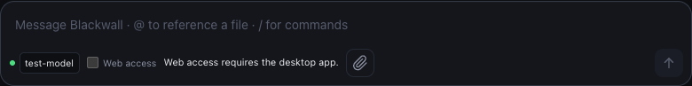

# Web access

Desktop Chat and Agent can search and read public pages when Web access is enabled. Owner and host
policy decisions still apply before network access. Browser mode has no shared-core tool backend:
its Web access checkbox is disabled with a visible explanation, and its IPC boundary rejects a web
request before contacting the model. Use the desktop app for research.



## Retrieval and failures

The built-in fetcher uses direct HTTP(S), verified TLS, pinned public DNS addresses, standard ports,
and no cookies, browser login, proxy, or referrer. It validates every redirect, checks that host's
permission, resolves and pins that destination independently, rejects mixed public/private DNS
answers, detects loops, and allows at most eight redirects. A redirect cannot transfer credentials
or reuse an earlier host's permission to override host rules. Reusable web permission retains its
existing scope; it never disables address validation.

Each hop has a five-second DNS timeout, a five-second connection timeout, and a 30-second request
timeout. Responses are limited to 2 MiB **after decompression**, counted while streaming rather than
trusting Content-Length. gzip, Brotli, and deflate are supported. The model receives at most 32,000
characters of text, with a trim notice, source URL and title. Source and diagnostic URLs omit query
strings, fragments and embedded credentials. The actual request still includes its query; search
approvals show the query separately so the owner can review what will be sent.

HTML extraction prefers article/main content, decodes entities, normalizes whitespace and removes
scripts, styles, templates, navigation and explicitly hidden elements. It does not execute
JavaScript or implement a browser's CSS/layout engine. Plain text, JSON and XHTML are supported;
PDFs, images and binary documents are refused. Text decoding honors a BOM, an HTTP charset, or an
HTML meta charset in the first 4 KiB, otherwise UTF-8. Unknown encodings and invalid text fail
explicitly. All source content remains untrusted.

Web failures carry `{"webError":{"category":"…","source":"…","message":"…"}}` in tool output,
with a typed core error and a stable category for telemetry. This preserves the existing event
protocol and saved conversations. The UI shows an actionable reason and source even with the tool
group collapsed. It preserves the protocol's `denied` bit through IPC and conversation storage,
so owner/policy denials are distinct from a website's HTTP 403. Other categories cover DNS, private
addresses, TLS, connectivity, timeouts, redirect loops/limits, HTTP 401/429, human-verification
challenges, unsupported documents/encodings, size limits, rendering needs and unavailable search.
Transport diagnostics classify the underlying cause without echoing raw errors or response headers.
Owner HTTP command tools explicitly disable automatic decoders and retain their identity-only,
64 KiB response contract despite reqwest's shared decoder features.

## Search-provider evaluation

DuckDuckGo HTML remains the default, credential-free provider. A search succeeds only when actual
result links can be extracted; a 200/202 interstitial is never passed along as successful results.
Challenge detection uses interstitial titles, challenge forms and Cloudflare's `cf-mitigated`
header. Ordinary articles mentioning challenges or including Cloudflare JavaScript detection
scripts are not by themselves treated as challenge pages. Detection is heuristic, not a promise to
recognize every site's interstitial. No usable result links means explicit `search_unavailable`,
including when the provider has no matches or changes its HTML. Results expose up to ten titles
and public URL candidates; fetching a candidate still requires DNS and policy validation.

There is deliberately no automatic cross-provider fallback: silently forwarding a query to another
company changes its disclosure and can create costs. A supported API is a better next provider
than another scraping endpoint. The evaluated candidate is [Brave Search API](https://api-dashboard.search.brave.com/documentation/quickstart),
which uses an owner-provided `X-Subscription-Token` and an activated plan. This change does not add a
Brave account, credentials, billing, or a built-in API integration. An owner can configure a search
MCP server in **Agent** today, review its data disclosure and provider charges, and store its
credentials through the existing credential-store flow. Desktop Chat's built-in web tools do not
automatically acquire Agent's MCP tools.

A future built-in provider interface should return normalized title/URL/snippet results and typed
unavailable/rate-limited failures. Select it explicitly in Settings, store its key in the platform
credential store, and show query disclosure and potential provider charges before activation.
Send the credential only to the fixed provider origin; never forward it on redirects or to result
pages. Missing/revoked credentials and 429 responses must fail explicitly, with no paid retries or
implicit fallback. No API smoke was performed without an owner-configured account.

## Browser-rendering evaluation

A headless browser could render public JavaScript-dependent pages, but adds a browser binary,
patching responsibility and resource cost. Its subrequests, redirects, WebSockets and DNS would
all need the same public-network boundary; validating only the top-level URL would weaken SSRF
protection. Reusing the owner's ordinary browser would also disclose cookies and account identity.
A remote renderer would disclose URLs and page data to another operator and may incur charges.

No browser binary, remote rendering service, login session or challenge-solving dependency is
introduced here. Empty static shells report `rendering_required`; a login/challenge asks for
another public source. [Cloudflare's challenge documentation](https://developers.cloudflare.com/cloudflare-challenges/challenge-types/challenge-pages/)
describes browser evaluation and possible human interaction; rendering alone does not guarantee
access. An eventual optional renderer needs explicit owner activation, an isolated session, bounded
CPU/download/output/time, subrequest enforcement and a useful login/human-interaction failure.
The browser UI should only enable Web access once it has an authenticated, owner-controlled
adapter to the shared core runtime, rather than arbitrary browser-side website fetches.

## Verification — 2026-11-02

The public probes below ran the actual shared-core retrieval path used by desktop, with TLS and
DNS/public-address checks enabled. They bypassed only interactive approval by an explicit test
allow decision; they did not run a model or the native desktop window. Counts include source/title
wrappers, so a clipped result can exceed 32,000 total characters.

| Public source | Desktop shared-core result | Browser UI |
| --- | --- | --- |
| `https://example.com/` | Readable text, title; 231 characters | Web access unavailable |
| `http://example.com/` | Readable text, title; 230 characters | Web access unavailable |
| [MDN CORS](https://developer.mozilla.org/en-US/docs/Web/HTTP/Guides/CORS) | Readable article; 27,473 characters | Web access unavailable |
| `https://github.com/` | Readable main content; 4,406 characters | Web access unavailable |
| [Wikipedia Rust](https://en.wikipedia.org/wiki/Rust_(programming_language)) | Readable text, clipped; 32,168 total characters | Web access unavailable |
| DuckDuckGo HTML, query `Rust documentation` | Parsed result titles and URLs; 728 characters | Web access unavailable |

The browser composer was also checked in Chromium with a mocked model catalog: Web access was
disabled and unchecked, with the visible desktop-app explanation (screenshot above). An offline
IPC test verifies browser web requests perform no fetch at all. Browser research through the model
is intentionally unavailable. Native desktop model-driven research was not manually exercised;
the scripted Chat/Agent and UI tests cover dispatch, approval, errors, storage and presentation.

Offline local-server fixtures cover useful HTML, >256 KiB pages, four redirects, loops, more than
eight redirects, cross-host denial, private/credential-bearing destinations, mixed DNS answers,
401/403/429, 200/202 challenges, compression and expansion limits, chunked oversized responses,
charsets/BOM/meta encodings, content types, connection/timeouts, sanitized diagnostics and bounded
parser fuzz cases. Site responses vary by network and time; success here promises no universal
website access. In particular, the earlier issue investigation observed a DuckDuckGo challenge on
the same day even though this run obtained results.

Re-run the opt-in network probe separately from the offline test suite:

```sh
cargo test --manifest-path src/Cargo.toml -p blackwall-core public_web_smoke -- --ignored --nocapture
```
